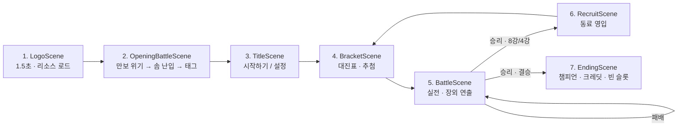

# 씬 구조와 씬플로우

> 보솜보솜 시연용 2D 실시간 배틀 웹게임 · 기준 해상도 1280×720 · Phaser 3
> 표기: **[확정]** CLAUDE.md에서 확정한 내용 · **[가정]** 바뀔 수 있으며 데이터로 조정 · **[추천]** 이 문서에서 정한 추천안

## 1. 한눈에 보기



| 요구 ID | 내용 | 관련 절 |
|---|---|---|
| REQ-001~007 | 씬 7개 각각의 동작 | 3절 |
| REQ-008 | 씬 사이 데이터 전달 | 2절 |
| REQ-009 | 3분 이내 완주 | 4절 |
| REQ-010 | 시연용 단축키 R, 1~3, 0 | 5절 |
| REQ-011 | 캐릭터 이미지가 없을 때 도형으로 대체 | 6절 |

## 2. 씬 사이에 전달되는 데이터 (REQ-008)

진행 상태는 `src/state/gameState.js`의 **게임 상태 객체 하나**에서만 관리합니다. 씬은 이 객체를 읽고, 씬을 시작할 때는 꼭 필요한 값만 `scene.start(key, data)`로 넘깁니다.

```js
// gameState (전역 상태는 이 객체 하나만 둔다)
{
  matchIndex: 0,              // 현재 경기 0=8강, 1=4강, 2=결승
  party: ["manbo", "som"],    // 파티 슬롯. 영입 멤버가 뒤에 추가된다(최대 4) [가정]
  recruits: [],               // 영입 기록 [{ matchIndex, teamId, characterId }]
  drawDone: false,            // 대진 추첨 연출을 봤는지
  retryCount: 0,              // 현재 경기 재도전 횟수(연출·로그용)
  settings: { volume: 0.7 }   // 사운드 크기 0~1, localStorage에 저장
}
```

| 보내는 씬 → 받는 씬 | 넘기는 값 | 게임 상태 변경 |
|---|---|---|
| Logo → Opening | 없음 | 상태 초기화 `reset()` |
| Opening → Title | 없음 | 없음 |
| Title → Bracket | 없음 | `matchIndex = 0` |
| Bracket → Battle | `{ matchIndex, opponentTeamId }` | `drawDone = true` |
| Battle → Battle (패배) | 같은 `{ matchIndex, opponentTeamId }` | `retryCount += 1` |
| Battle → Recruit (승리) | `{ matchIndex, opponentTeamId, candidateId }` | `retryCount = 0` |
| Recruit → Bracket | 없음 | `party`·`recruits`에 추가, `matchIndex += 1` |
| Battle → Ending (결승 승리) | 없음 | 없음 |

- 상대 팀, 영입 후보, 연출 문구는 `data/teams.json`, `data/bracket.json`, `data/texts.json`에서 `id`로 찾습니다.
- 결승인지는 `matchIndex === bracket.matches.length - 1`로 판단합니다. 경기 수가 바뀌어도 코드는 그대로 둡니다. [가정 대응]

## 3. 씬별 상세 (REQ-001~007)

### 3-1. LogoScene — 목표 1.5초
- **화면**: 검은 배경, 가운데 팀 로고 "보솜보솜"(이미지가 없으면 텍스트), 하단에 얇은 로딩 바(로드가 끝나지 않았을 때만 표시)
- **동작**: 0.5초 페이드인 → 0.5초 유지 → 0.5초 페이드아웃. 그 사이 `data/*.json`, 캐릭터 이미지, 사운드를 모두 선로드합니다.
- **입력**: 클릭 또는 아무 키 → 바로 다음 씬. 이 첫 클릭으로 사운드 재생을 허용받습니다. [확정]
- **다음 씬 조건**: 연출 종료 또는 클릭 **그리고** 로드 완료 → OpeningBattleScene
- **예외**: 개별 파일 로드 실패는 경고만 남기고 넘어갑니다(이미지가 없으면 도형 사용). JSON 검증 오류는 콘솔에 적고 기본값으로 진행합니다.

### 3-2. OpeningBattleScene — 목표 25초 (상한 30초)
- **화면**: 실제 BattleScene과 같은 전투 화면과 UI. 상대는 이름 없는 강한 라이벌 1명입니다.
- **진행(스크립트)**
  1. 0~10초: 만보 혼자 싸움. 상대가 훨씬 강해 만보의 체력이 빠르게 줄어듭니다.
  2. 만보 체력이 30% 이하이거나 12초가 지나면 → 슬로 모션, 솜 난입 컷인
  3. 태그 키 아이콘만 크게 깜빡입니다(설명 문장 없음). 누르면 교체와 합동기 발동
  4. 합동기 적중 → 상대가 장외로 날아감 → 화면 암전
- **입력**: 이동, 기본 공격, 스킬, 태그(아래 키 배치 참고)
- **다음 씬 조건**: 장외 연출 종료 → TitleScene
- **안전 장치**: 만보는 체력 1 아래로 내려가지 않습니다. 태그 안내 후 5초 동안 입력이 없으면 자동으로 태그합니다. → 이 씬에서는 실패가 없습니다.

> **[추천] 키 배치** (최종 값은 battle-designer가 정함): 이동 `←→` 또는 `A D`, 점프 `↑` 또는 `W`, 기본 공격 `J`, 스킬 `K`·`L`, 태그 `Space`.
> 숫자 키는 시연용 단축키로 쓰기 때문에 전투 조작에 배정하지 않습니다.

### 3-3. TitleScene — 목표 5초
- **화면**: 게임 제목, 메뉴 `시작하기`·`설정`, 배경에 만보와 솜. 게임 종료 메뉴는 없습니다. [확정]
- **설정**: 별도 씬을 만들지 않고 같은 씬 위에 패널을 띄웁니다. [추천] 사운드 크기 슬라이더(0~100)와 닫기 버튼만 둡니다.
- **입력**: 마우스 클릭, `↑↓` + `Enter`
- **다음 씬 조건**: `시작하기` → BracketScene

### 3-4. BracketScene — 목표 첫 방문 8초, 이후 4초
- **화면**: 10개 팀이 표시된 토너먼트 대진표. 우리 팀을 강조하고, 다음 경기 노드는 빛나는 버튼으로 표시합니다.
- **10팀 배치 [추천]**: 예선 2경기(4팀)와 시드 6팀 → 8강 → 4강 → 결승. 우리 팀은 시드에서 시작해 3경기를 치릅니다. [가정: 3경기]
- **첫 방문**: 상대 팀 추첨 룰렛(약 3초)을 보여 줍니다. 결과는 `bracket.json`에 고정된 순서를 씁니다. [추천] 시연마다 같은 흐름이 나와야 하기 때문입니다.
- **다시 방문**: 추첨 없이 직전 경기 승리선이 이어지는 연출(1초)만 보여 줍니다. 다른 경기 결과도 데이터에 고정합니다.
- **입력**: 다음 경기 노드 클릭 또는 `Enter`
- **다음 씬 조건**: 노드 클릭 → BattleScene `{ matchIndex, opponentTeamId }`

### 3-5. BattleScene — 목표 8강·4강 25초, 결승 30초
- **화면**
  - 위쪽: 양 팀 체력바(이름, 현재 캐릭터 얼굴 또는 도형 아이콘)
  - 아래쪽: 스킬 2개의 쿨타임 원형 게이지, 태그 게이지, 어시스트 아이콘(영입 멤버) [가정]
  - 가운데: 스테이지(양 끝이 화면 밖으로 열린 무대)
- **입력**: 3-2의 키 배치와 같음. 태그 게이지가 차 있을 때만 태그와 합동기가 나갑니다.
- **승리**: 상대 체력 0 → 히트 스톱 → 장외로 날아감(카메라 흔들림, 별이 되는 반짝임) → 2초 뒤 종료
  - 8강·4강 → RecruitScene / 결승 → EndingScene
- **패배**: 만보와 솜 모두 쓰러짐 → "다시 한 번!" 1초 표시 → **같은 경기 즉시 재시작**(대진표를 거치지 않음)
- **규칙 위치**: 피해, 쿨타임, 승패 판정은 `src/battle/`의 순수 함수가 맡고, 씬은 입력과 표현만 담당합니다.

### 3-6. RecruitScene — 목표 6초
- **화면**: 쓰러졌던 상대 멤버가 일어나 다가오는 모습 → 말풍선 "○○이(가) 동료가 되고 싶어 한다!" → 아래 파티 슬롯 4칸 중 빈 칸에 들어가는 연출
- **입력**: 클릭 또는 `Enter`로 건너뜀. 입력이 없어도 연출이 끝나면 자동으로 진행합니다. [추천]
- **다음 씬 조건**: 슬롯 연출 종료 → BracketScene(`matchIndex + 1`)
- **건너뜀**: 결승 승리 후에는 이 씬을 거치지 않습니다. 파티가 가득 차 있으면 문구만 보여 주고 넘어갑니다.

### 3-7. EndingScene — 목표 18초
| 단계 | 시간 | 화면 |
|---|---|---|
| ① 챔피언 등극 | 5초 | 트로피, 파티 전원 등장, 꽃가루 |
| ② 개발 로그 크레딧 | 9초 | "기획부터 구현까지 4일" → Day 1~4 한 줄씩 위로 흐름 (`texts.json`) |
| ③ 마지막 화면 | 4초 + 유지 | "챔피언 팀의 다음 동료는?" + 빛나는 빈 슬롯 1칸 |

- **입력**: ①②는 클릭하면 다음 단계로 넘어갑니다. ③은 자동으로 넘어가지 않고 멈춘 채 유지됩니다(발표 멘트로 이어짐).
- **다음 씬 조건**: 없음. `R`을 누를 때만 처음으로 돌아갑니다.

## 4. 소요 시간 확인 (REQ-009)

| 순서 | 씬 | 목표 시간 | 누적 |
|---|---|---|---|
| 1 | LogoScene | 1.5초 | 0:01.5 |
| 2 | OpeningBattleScene | 25초 | 0:26.5 |
| 3 | TitleScene | 5초 | 0:31.5 |
| 4 | BracketScene (추첨) | 8초 | 0:39.5 |
| 5 | BattleScene 8강 | 25초 | 1:04.5 |
| 6 | RecruitScene | 6초 | 1:10.5 |
| 7 | BracketScene | 4초 | 1:14.5 |
| 8 | BattleScene 4강 | 25초 | 1:39.5 |
| 9 | RecruitScene | 6초 | 1:45.5 |
| 10 | BracketScene | 4초 | 1:49.5 |
| 11 | BattleScene 결승 | 30초 | 2:19.5 |
| 12 | EndingScene (③ 도달까지) | 18초 | **2:37.5** |

- **합계 약 2분 38초**로 3분 이내입니다. 여유 22초는 재도전 한 번(약 15~25초)을 감당할 수 있는 정도입니다.
- 전투 시간은 상대 체력과 피해 수치(JSON)로 맞춥니다. 경기마다 25초를 넘기면 상대 체력부터 줄입니다.
- 검증은 구현 후 실제 플레이 시간을 재어 이 표를 갱신합니다. (아직 측정하지 않음)

## 5. 시연용 단축키 (REQ-010)

- **처리 위치 [추천]**: `src/main.js`의 `bindDemoHotkeys(game)` 한 곳에서 `window`의 `keydown`을 받습니다. 각 씬에 따로 넣지 않습니다.
- 동작 순서: 실행 중인 씬을 모두 정지 → `gameState`를 해당 시점의 프리셋으로 설정 → 대상 씬 시작
- **경기 프리셋**: N번 경기로 이동하면 그 전 경기들의 영입이 끝난 파티를 `bracket.json` 순서대로 자동으로 채웁니다. (예: `3` → 파티 4인, 결승)

| 키 | 동작 | Logo (로드 중) | Logo (로드 후) ~ Ending |
|---|---|---|---|
| `R` | 처음부터 다시 | 무시 | 상태 초기화 → LogoScene (리소스가 캐시되어 1.5초 연출만) |
| `1` | 8강으로 | 무시 | BattleScene `matchIndex 0`, 파티 2인 |
| `2` | 4강으로 | 무시 | BattleScene `matchIndex 1`, 파티 3인 |
| `3` | 결승으로 | 무시 | BattleScene `matchIndex 2`, 파티 4인 |
| `0` | 엔딩으로 | 무시 | EndingScene, 파티 4인 |

- 로드가 끝나기 전에는 이동할 씬의 리소스가 없으므로 모든 단축키를 무시합니다.
- 단축키는 대진표와 추첨 연출을 건너뛰고 전투로 바로 들어갑니다(`drawDone = true`로 설정).
- TitleScene 설정 패널이 열려 있어도 동작합니다. 패널은 씬 정지와 함께 닫힙니다.
- 경기 수가 바뀌면 [가정] 숫자 키는 존재하는 경기까지만 동작하고 나머지는 무시합니다.

## 6. 캐릭터 이미지가 없을 때 도형으로 대체 (REQ-011)

- **결정 위치는 한 곳**: `src/ui/characterView.js`의 `createCharacterView(scene, characterId)`
  - `scene.textures.exists(characterId)`가 참이면 → 이미지 스프라이트(512×512를 화면에서 0.25배, 128px)
  - 거짓이면 → 아래 규칙의 도형. 반환 객체의 인터페이스(위치, 좌우 반전, 피격 깜빡임)는 두 경우가 같습니다.
- **로드**: LogoScene이 `characters.json`의 모든 id에 대해 `assets/characters/<id>.png`를 시도합니다. 실패해도 오류로 멈추지 않습니다. 파일을 넣기만 하면 다음 실행부터 이미지가 나옵니다.

| 요소 | 도형 표현 |
|---|---|
| 몸체 | 역할별 모양: 탱커 = 둥근 사각형, 설계·지원 = 육각형, 공격 = 삼각형 (`characters.json`의 `role`) |
| 색 | 캐릭터 `color` 값. 없으면 팀 색상 |
| 이름 | 몸체 가운데에 이름 첫 글자(예: 만, 솜) |
| 바라보는 방향 | 진행 방향 쪽에 눈 점 2개 |
| UI 아이콘 | 체력바 옆과 파티 슬롯에 같은 도형을 작게 표시 |

- 로고 이미지가 없으면 "보솜보솜" 텍스트로, 배경 이미지가 없으면 단색 그라데이션으로 대체합니다.

## 7. 남은 미정 사항
- 영입 인원, 경기 수, 어시스트 방식은 솜님과 확정이 필요합니다. 데이터로 바꿀 수 있게 설계했습니다.
- 키 배치는 battle-designer의 전투 설계에서 확정합니다.
- 팀명과 Day 1~4 개발 로그 문구는 `texts.json`에 채워야 합니다.
