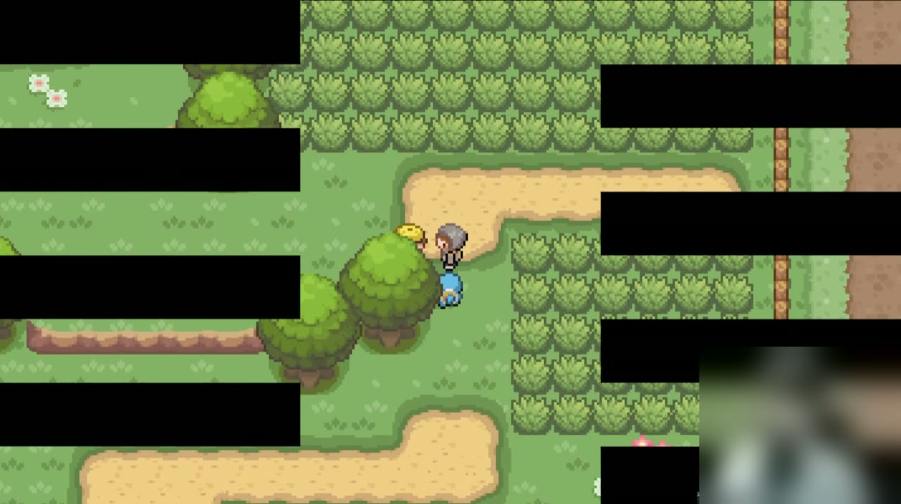
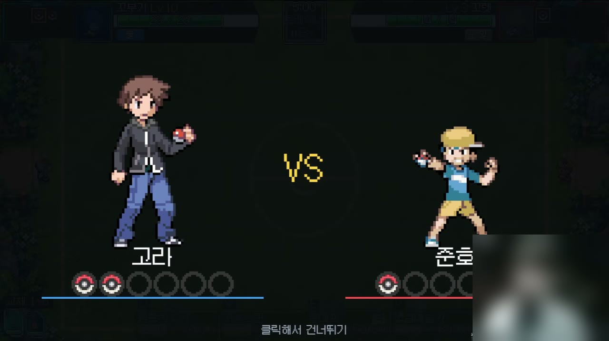
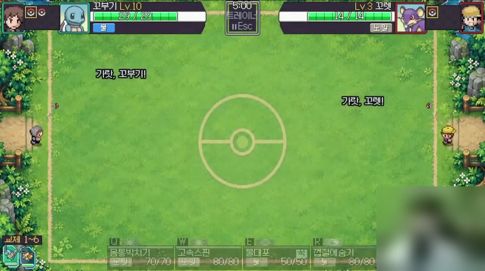
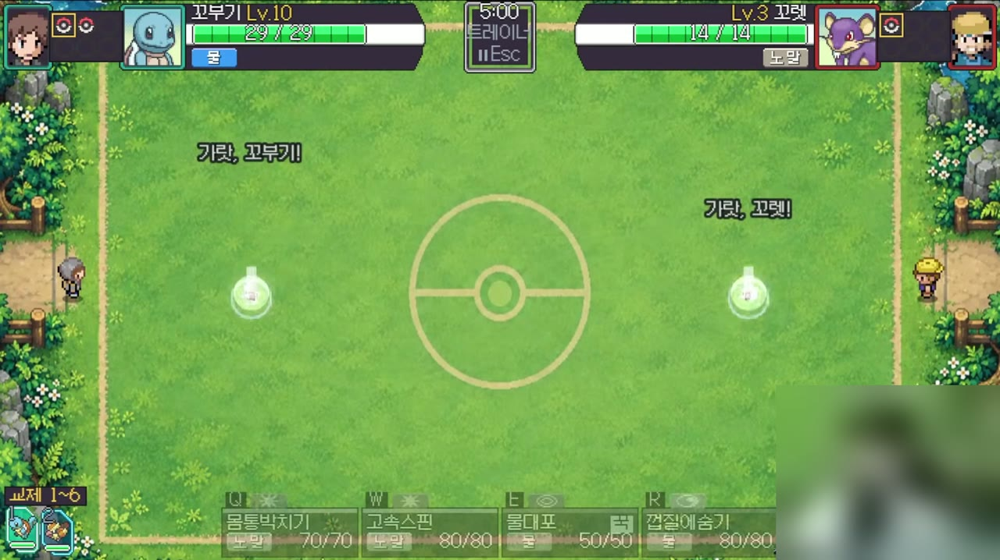
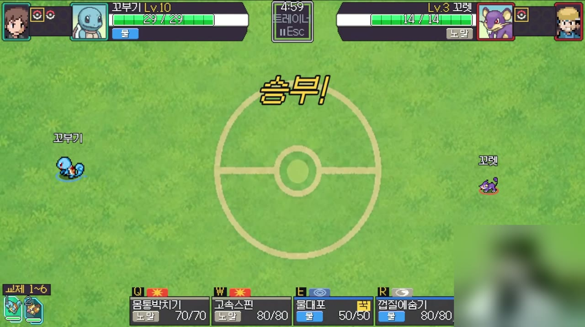
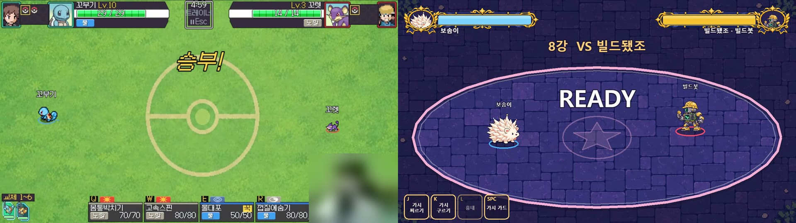
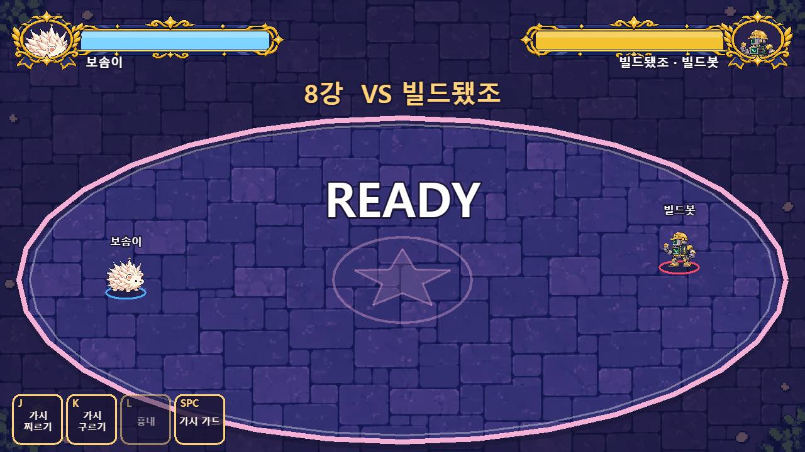

# 레퍼런스 영상 분석 2 — 전투 시작 연출과 경기장·캐릭터 크기 (2026-11-27)

> 구조와 연출 감각만 참고한다. 원작 캐릭터·스프라이트·효과음·UI 그림은 가져오지 않는다.
> 첨부 이미지는 분석용 스틸이며 오른쪽 아래 스트리머 웹캠은 흐리게 처리했다. 공개 배포 전에 삭제하거나 `.gitignore` 처리할지 결정한다(1차 분석과 같은 기준).

## 1. 소스와 방법
| 항목 | 값 |
|---|---|
| 원본 | `C:\bosombosom\docs\references\video\resonance_ref2.mp4` |
| 길이 / 해상도 / 프레임 | **21.87초**, **1920×1076**, 30fps (H.264, AAC) |
| 도구 | ffmpeg 9.1 (`Gyan.FFmpeg`) |
| 1차 추출 | 1초 1장, 22장 → `C:\bosombosom\docs\references\frames_ref2\1fps\` (+ 시간 표시 묶음 `sheet_1fps_1~2.jpg`) |
| 2차 추출 | 시작 연출 구간 0.5~8.0초를 1초 10장, 75장 → `...\frames_ref2\10fps\` (+ 묶음 `sheet10_0.8 / 3.6 / 5.6.jpg`) |
| 측정용 원본 프레임 | `...\frames_ref2\full\t_*.jpg` (1920×1076 그대로) |

- **제외 영역:** 오른쪽 아래 웹캠과 첫 프레임의 유튜브 재생바는 분석하지 않았다.
- **분석 범위:** 0~19초. 19.5초 이후는 필드 화면(경험치 대사)으로 돌아간다.
- **측정 방법:** 1920×1076 원본 프레임에서 픽셀 좌표를 직접 읽고 화면 대비 %로 바꿨다. 우리 게임은 1280×720 스크린샷으로 쟀다.

## 2. 전투 시작 연출

### 2-1. 타임라인 (녹화 기준 초)
| 시간 | 길이 | 일어난 일 | 카메라 | 조작 |
|---|---|---|---|---|
| 0.0~1.0 | 1.0 | 필드에서 상대 트레이너 대사창("한 수 가르쳐 줄게!") | 고정 | 불가 |
| **1.1~1.7** | **0.6** | **가로 줄무늬 전환**: 검은 가로 띠 8줄이 왼쪽·오른쪽에서 번갈아 밀려 들어와 화면을 덮는다 → 1.7초에 완전 암전 | 고정 | 불가 |
| 1.8~2.0 | 0.2 | **VS 카드 등장**: 검은 배경, 두 트레이너 전신이 화면 양끝에서 미끄러져 들어온다 | 고정 | 불가 |
| 2.0~4.2 | 2.2 | **VS 카드 유지**: 왼쪽 내 트레이너(오른쪽을 봄), 오른쪽 상대(왼쪽을 봄), 가운데 노란 `VS`, 각자 아래에 이름과 파티 몬스터볼 줄. 밑줄 색은 **내 쪽 파랑, 상대 빨강**. 아래에 작게 `클릭해서 건너뛰기` | 고정 | 건너뛰기만 가능 |
| **4.3~4.6** | **0.3** | **경기장으로 컷 + 검은색에서 밝아짐**. 첫 프레임부터 위쪽 HP 바·타이머(`5:00`)와 아래쪽 기술칸이 **이미 떠 있다**(기술칸은 반투명) | **넓은 화면**: 경기장 테두리(나무 울타리·숲)까지 다 보임 | 불가 |
| 4.3~4.8 | 0.5 | 두 트레이너가 경기장 **좌우 바깥 가장자리**에 서 있고, 각자 머리 위에 `가랏, ○○!` 외침 문구. 몬스터볼이 경기장 안쪽 시작 지점으로 굴러 감 | 넓은 화면 고정 | 불가 |
| **4.9~5.3** | **0.4** | **등장 섬광**: 시작 지점 두 곳에 흰 빛점 → 흰 실루엣 → 0.4초 만에 원래 색. 이름표가 머리 위에 붙는다 | 넓은 화면 고정 | 불가 |
| **5.5~6.2** | **0.7** | **카메라 줌 인**: 넓은 화면 → 전투 화면. 가운데 원 지름 기준 **약 1.6배 확대**. 경기장 테두리가 화면 밖으로 나간다 | 줌 인 + 가운데 정렬 | 불가 |
| **6.3** | — | **`승부!`** 노란 기울임 글씨가 위쪽 가운데에 뜬다(약 1.5초 유지). 같은 순간 타이머가 `5:00 → 4:59`로 흐르기 시작 | 전투 화면 | **이때부터 가능** |
| 7.0 | — | 내가 첫 기술(`껍질에숨기`)을 씀. 왼쪽 위에 기술 라벨 | 이후 카메라가 두 캐릭터를 따라 움직임 | 가능 |

**요약:** 암전 전환 0.6초 → VS 카드 2.4초 → 넓은 화면 등장 1.2초 → 줌 인 0.7초 → "승부!"와 함께 조작 시작. 전환이 시작된 뒤 조작까지 **약 5.2초**가 걸린다(VS 카드를 건너뛰면 약 2.8초).

### 2-2. 연출 포인트
- **등장 순서:** 트레이너(사람)가 먼저 VS 카드로 소개되고, 경기장에서는 사람은 가장자리에 서 있고 **몬스터가 시작 지점에 동시에** 나타난다. 한쪽씩 따로 등장하지 않는다.
- **마주보는 구도:** VS 카드와 경기장 모두 **왼쪽 = 나, 오른쪽 = 상대**이고 서로를 바라본다. 시작 지점은 같은 높이(가운데 선 근처)에 좌우 대칭이다.
- **문구 순서:** VS 카드의 이름 → 경기장 HUD 이름·HP(컷과 동시에) → 외침 `가랏, ○○!` → 머리 위 이름표 → `승부!`
- **HUD:** 컷과 동시에 이미 있다. 따로 차오르는 애니메이션은 없다. 기술칸은 조작 전까지 반투명이다.
- **카메라:** 등장은 넓은 화면(경기장 전체)에서 보여 주고, 전투는 확대한 화면에서 한다. 경기장이 화면보다 커서 전투 중에는 카메라가 캐릭터를 따라간다.

## 3. 경기장과 캐릭터 크기 비율

| 항목 | 레퍼런스 (전투 화면, 1.6배 줌 후) | 현재 우리 게임 (1280×720) |
|---|---|---|
| 캐릭터 1명 높이 (화면 높이 대비) | **약 6~7%** (꼬부기 약 75px / 1076, 꼬렛 약 60px) | **약 13~14%** (보솜이 약 100px, 빌드봇 약 95px / 720) |
| 이름표 포함 높이 | 약 14% | 약 19% |
| 캐릭터 너비 (화면 너비 대비) | 약 5% | 약 8% |
| 움직일 수 있는 경기장 | 화면보다 큼: 넓은 화면 기준 화면의 약 80%×92% → 1.6배 줌 후 **화면 전체(100%)를 채우고 바깥으로 더 이어짐** | 타원 링: 가로 1184px(92%) × 세로 452px(63%), **면적은 화면의 약 46%** |
| 시작 위치 두 캐릭터 거리 (화면 너비 대비) | **약 71%** (x 230 ↔ 1600 / 1920) | **약 47%** (x 340 ↔ 940 / 1280) |
| 캐릭터 높이 : 경기장 세로 | 약 1 : 15 이상 | 약 1 : 4.5 |
| 가장자리 표현 | 사각형 필드. 흙길·나무 울타리 테두리, 그 바깥은 숲·바위(장외 개념 없음, 넘어갈 수 없는 벽) | 타원 링 선(분홍) + 바깥을 어둡게 한 장외 구역. 평소에는 못 나가고 마무리 일격 때만 장외로 날아감 |
| 위쪽 UI | 높이 약 12.5%(0~135px), 화면 가로 전체. HP 바·초상·타이머 | 높이 약 20%(0~150px, 기술 라벨 포함), 좌우 모서리 |
| 아래쪽 UI | 높이 약 12%. 기술 4칸이 **아래 가운데**(가로 55%), 교체칸 왼쪽 | 기술 4칸이 **아래 왼쪽**(가로 28%, 높이 약 12%) |
| UI가 필드를 가리는 방식 | 필드 위에 겹쳐 그림(필드가 UI 밑까지 이어짐) | 같음. 링은 HUD 사이 공간에 들어가 있음 |

**결론:**
- 우리 캐릭터는 레퍼런스의 **약 2배**로 크다.
- 경기장은 화면 면적의 절반 정도만 쓴다.
- 시작 거리가 짧아서 시작하자마자 붙는다.

레퍼런스처럼 경기장을 화면보다 크게 만들고 카메라를 따라가게 하면 "한 화면 경기장"(CLAUDE.md 3절) 결정이 바뀌고 작업이 커진다. 그래서 **한 화면 유지 + 캐릭터 축소 + 링 확대**로 같은 감각을 낸다.

## 4. 우리 게임 적용안 (1280×720 기준)

### 4-1. 크기 수치 (모두 `data/stages.json`의 `arenaDefaults`에서 조정)
| 키 | 현재 | 제안 | 결과 |
|---|---|---|---|
| `unitScale` (캐릭터 크기 배율) | 0.62 | **0.36** | 보솜이 이미지 69px(보이는 높이 약 62px, **8.6%**), 라이벌 81px(약 73px, **10%**). 레퍼런스 7%보다 살짝 크게 둔다. 발표장 프로젝터에서 솜님 원화가 보여야 하므로 |
| `bodyRadius` (신규, 몸 반지름 = 충돌·링 여백) | 코드 고정 40 | **26** | 캐릭터 축소에 맞춤. 발밑 링·그림자도 이 값에 비례 |
| `cx`, `cy` | 640, 444 | **640, 446** | |
| `rx`, `ry` (링 반지름) | 592, 226 | **610, 258** | 링 1220×516px(가로 95%, 세로 72%), **면적 약 54%**. 위 끝 y=188(기술 라벨 아래), 아래 끝 y=704 |
| `startOffsetX` (신규, 가운데에서 시작 위치까지) | 코드 고정 300 | **440** | 보솜이 (200, 466), 라이벌 (1080, 426). **거리 880px = 69%** |
| `startOffsetY` (신규) | 코드 고정 ±20 | **20** | 보솜이는 가운데보다 20px 아래, 라이벌은 20px 위 (서로 마주보는 대각 느낌 유지) |
- 캐릭터 높이 : 링 세로 = 약 1 : 7~8. 레퍼런스(1:15)만큼은 아니지만 지금(1:4.5)보다 두 배 가까이 넓게 느껴진다.
- 기술 사거리(`skills.json`의 `range`·`radius`·`length`)는 바닥 px 단위라 그대로 두면 캐릭터 대비 범위가 커진다. 레퍼런스도 범위 표시가 캐릭터보다 훨씬 크므로 일단 유지하고, 플레이 후 P1에서 조정한다.

### 4-2. 전투 시작 연출 (3초 이내로 압축)
레퍼런스의 5.2초를 다음처럼 **2.65초**로 줄인다(조작 시작 1.75초).

| 시간 | 길이 | 연출 | 레퍼런스 대응 |
|---|---|---|---|
| 0.00~0.35 | 0.35 | 대진표 → 전투 전환: 검은 가로 띠 8줄이 좌우 번갈아 밀려 들어옴 | 줄무늬 전환 0.6초 |
| 0.35~1.25 | 0.90 | **VS 카드**: 검은 배경, 왼쪽 보솜이 원화(오른쪽을 봄)·`보솜보솜` 파란 밑줄, 오른쪽 라이벌 원화(왼쪽을 봄)·팀 이름 빨간 밑줄, 가운데 노란 `VS`, 위에 `8강`. 두 캐릭터가 양끝에서 0.15초 만에 미끄러져 들어옴 | VS 카드 2.4초 |
| 1.25~1.75 | 0.50 | **경기장 컷**: HUD는 처음부터 있고 기술칸은 반투명. 시작 지점 두 곳에 흰 섬광 → 흰 실루엣 → 원래 색(동시에) | 넓은 화면 등장 + 섬광 |
| 1.75 | — | **`승부!` 배너 + 조작 시작**, 기술칸 불투명 | 승부! = 조작 시작 |
| 1.75~2.65 | 0.90 | `승부!` 배너 유지 후 사라짐 | 승부! 약 1.5초 |

- **카메라:** 고정. 한 화면 경기장이라 넓은 화면이 곧 전투 화면이므로 줌 인을 넣지 않는다(넣으면 링이 화면 밖으로 잘림).
- **지금 있는 `READY` 글씨와 위쪽 `8강 VS 빌드됐조` 문구는 없앤다.** VS 카드가 그 역할을 맡는다.
- **건너뛰기:** VS 카드는 클릭·Enter·Space로 건너뛴다. 패배 후 재도전과 숫자키 1~3으로 들어올 때는 VS 카드를 생략하고 등장 섬광부터 시작한다(재도전은 빨라야 함).
- **3경기 합계:** 지금(경기당 READY 0.8초)보다 경기당 약 1초가 늘어 총 약 +3초. 3분 예산 안이다.
- **데이터:** 길이는 `data/stages.json`의 `battleIntro`(`wipeMs`, `vsMs`, `sendOutMs`, `bannerMs`)에, 문구는 `texts.json`(`fight`, 신규 `vsLabel`)에 둔다.

### 4-3. 작업 목록 (오늘 구현 순서)
| 순위 | 담당 | 작업 | 파일 | 완료 기준 | 예상 |
|---|---|---|---|---|---|
| **P0-1** | battle-designer | 4-1 수치 반영: `unitScale` 0.36, `bodyRadius` 26, `rx` 610, `ry` 258, `cy` 446, `startOffsetX` 440, `startOffsetY` 20. `docs/data-guide.md`에 새 키 설명 | `data/stages.json`, `docs/data-guide.md` | JSON만 고쳐 크기·시작 위치가 바뀜 | 15분 |
| **P0-2** | web-game-developer | 새 키 읽기: `Fighter`의 몸 반지름·발밑 링·그림자를 `bodyRadius`에 비례, 시작 위치를 `startOffsetX/Y`로, `loadData`에서 숫자 검사 | `src/battle/fighter.js`, `src/scenes/BattleScene.js`, `src/data/loadData.js` | 3경기 스크린샷에서 캐릭터 약 9~10%, 시작 거리 약 69% | 30분 |
| **P0-3** | web-game-developer | 전투 시작 연출 4-2: 줄무늬 전환 → VS 카드 → 등장 섬광 → 승부!(조작 시작). READY·위쪽 대진 문구 제거, 건너뛰기, 재도전·숫자키는 VS 생략 | `src/scenes/BattleScene.js`(`setupMode`), `src/scenes/BracketScene.js`(`enter` 전환), `data/stages.json`(`battleIntro`), `data/texts.json` | 조작까지 1.75초, 배너 끝 2.65초, `?auto=1` 완주 오류 0 | 1시간 |
| **P0-4** | battle-designer | 축소 후 손맛 점검: 기본 공격 `range`·가시 구르기 `length`·라이벌 `speed`를 한 판씩 직접 해 보고 조정(경기당 30~40초) | `data/skills.json`, `data/characters.json` | 3경기 사람 플레이 2분 30초 이내 | 30분 |
| P1-1 | web-game-developer | 기술칸을 아래 가운데로 옮김(레퍼런스 배치). 링 아래쪽과 겹침 줄이기 | `src/ui/hud.js` | 기술칸이 링 선을 가리지 않음 | 20분 |
| P1-2 | web-game-developer | 등장 때 `가랏, 보솜이!` / 라이벌 외침 문구 0.5초 (`texts.json`) | `BattleScene` | 문구가 등장 섬광과 함께 뜸 | 15분 |
| P2 | — | 화면보다 큰 경기장 + 따라가는 카메라, 사각 필드·울타리 테두리 | — | 발표 후 (한 화면 경기장 결정과 충돌) | — |

**P0-1·P0-2 적용 결과 (03:58):** 아래가 수치 적용 직후 화면이다. 보솜이 약 60px(8%), 빌드봇 약 70px(10%), 시작 거리 880px(69%).

**검증:** P0 묶음 뒤 `?start=1~3`과 처음부터 `?auto=1` 완주로 콘솔 오류·씬 전환·시간을 확인하고, 1차 분석과 같은 위치에서 스크린샷을 다시 찍어 위 표의 "현재" 열을 갱신한다.
