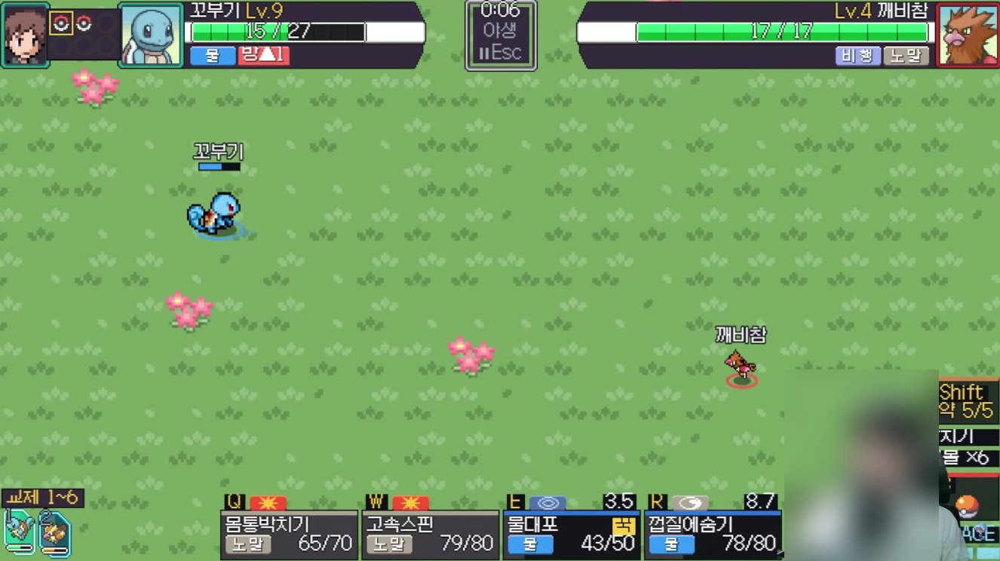
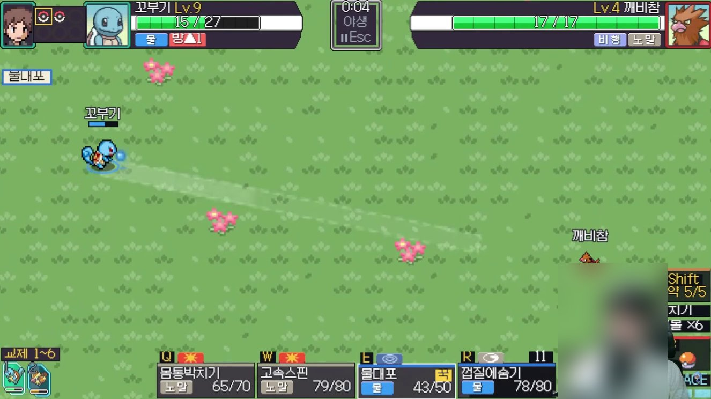
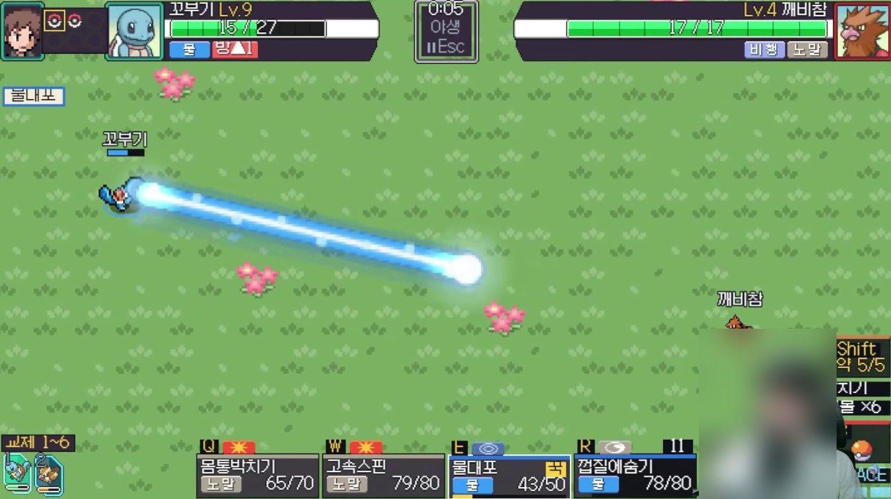
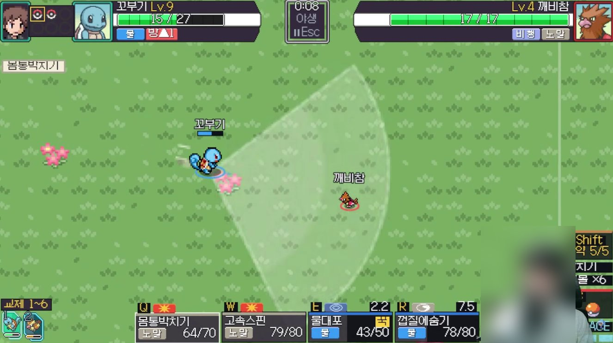
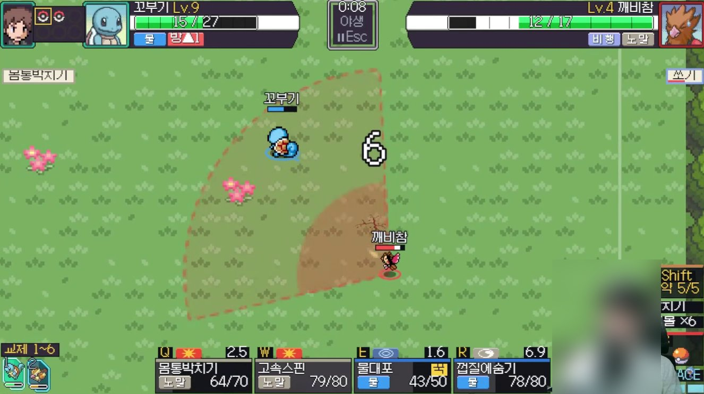
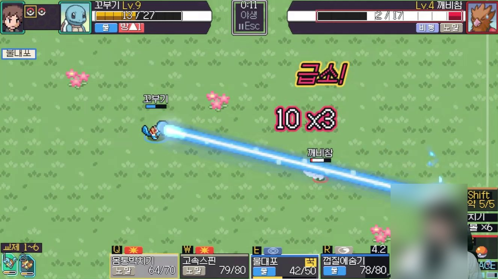
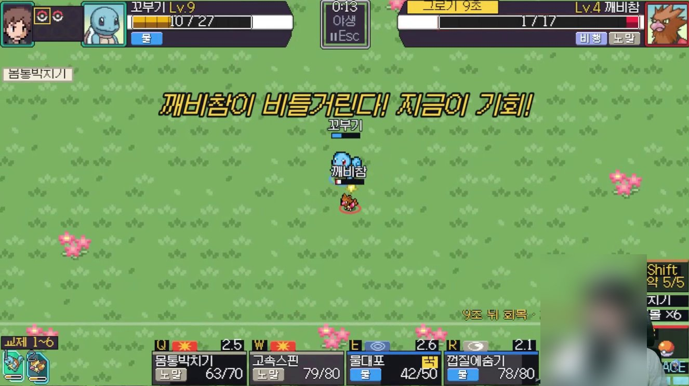
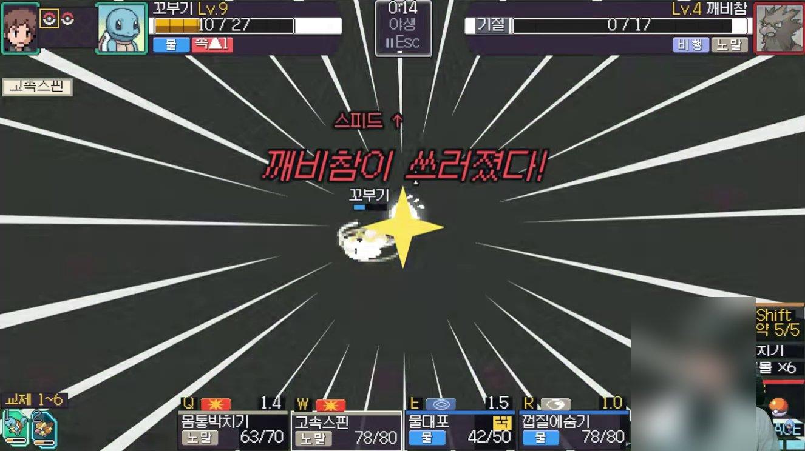

# 레퍼런스 영상 분석 — 포켓몬 레조넌스 실시간 전투 (2026-11-27)

> 구조와 연출 감각만 참고한다. 원작 캐릭터·스프라이트·효과음·UI 그림은 가져오지 않는다.
> 첨부 이미지는 분석용 스틸이며, 스트리머 웹캠 영역은 흐리게 처리했다. 공개 배포(GitHub Pages)에 포함할지는 발표 전에 결정한다(추천: 배포 전 삭제 또는 `.gitignore`).

## 1. 소스와 방법
| 항목 | 값 |
|---|---|
| 원본 | 유튜브 플레이 영상 10:20~10:40 구간 녹화 |
| 파일 | `C:\bosombosom\docs\references\video\resonance_fight_ref.mp4` |
| 길이 / 해상도 / 프레임 | **20.48초**, **1326×744**, 30fps (H.264, AAC) |
| 도구 | ffmpeg 9.1 (winget `Gyan.FFmpeg`로 설치) |
| 1차 추출 | 1초 1장, 20장 → `C:\bosombosom\docs\references\frames\1fps\` |
| 2차 추출 | 1초 10장, 4구간 97장 → `...\frames\10fps\` (`a_beam` 3.8~6.0초, `b_cone` 7.5~9.5초, `c_crit` 10.0~12.5초, `d_finish` 13.3~16.3초) |

- **앞뒤 여유:** 요청에는 앞뒤 2초 여유가 있다고 했지만, 실제로는 0초부터 바로 전투가 시작된다("승부!", 게임 타이머 0:00). 첫 프레임에만 유튜브 재생바(10:21)가 보인다. 뒤쪽은 19초부터 필드 화면으로 바뀌므로 **19.0초 이후를 분석에서 뺐다**.
- **제외 영역:** 오른쪽 아래 스트리머 웹캠과 유튜브 재생바는 분석하지 않았다.
- **시간 표기:** 아래 시간은 녹화 기준(초)이다. 게임 안 타이머는 녹화 시간보다 약 0.5~1초 늦다.

## 2. 화면 구성

| 위치 | 요소 | 메모 |
|---|---|---|
| 위 왼쪽 | 트레이너 초상, 내 몬스터 초상, 이름·레벨, HP 바(숫자 `15 / 27`), 타입 칩, 능력 변화 칩(`방▲1`) | HP 바는 칸 눈금이 있다. 맞으면 흰 잔상 바가 남았다가 줄어든다. 체력이 줄면 초록 → 노랑 → 빨강으로 바뀐다 |
| 위 가운데 | 타이머 `0:06`, 전투 종류(`야생`), `Esc` 일시정지 | 작은 박스 |
| 위 오른쪽 | 상대 이름·레벨, HP 바, 타입 칩, 초상 | 내 쪽과 좌우 대칭. 쓰러지면 초상이 회색이 되고 HP 바 앞에 `기절` 칩이 붙는다 |
| 위 모서리 아래 | **기술 이름 라벨**: 내 기술은 왼쪽, 상대 기술은 오른쪽 | 작은 흰 박스. 기술을 쓰는 동안 계속 떠 있다 |
| 필드 | 캐릭터 머리 위 이름표. 내 캐릭터는 이름 아래에 작은 파란 게이지가 있다. 발밑 링은 내 쪽 파랑, 상대 빨강 | 캐릭터는 화면 높이의 약 1/12로 작고, 필드가 화면 전체를 채운다 |
| 아래 왼쪽 | `교체 1~6`, 파티 아이콘 | |
| 아래 가운데 | 기술 4칸 `Q W E R`. 칸마다 키 글자, 타입 아이콘, 이름, 타입 칩, PP `65/70` | **쿨타임은 칸 오른쪽 위의 숫자(초, 소수 1자리)**로 표시한다. 쓰는 중이거나 쓸 수 없는 칸은 회색으로 바뀐다 |
| 아래 오른쪽 | `Shift` 가방(약 5/5), 퀵슬롯, `SPACE` 회피 충전 | |

## 3. 조작 흐름과 리듬
- 패턴은 **"거리 벌리기 → 원거리 기술 → 접근하는 상대에게 근접 기술 → 다시 거리"**의 반복이다. 기술 사이 간격은 약 1.5~3초다.
- 20초 동안 내가 쓴 기술은 6번이다: 고속스핀 → 껍질에숨기 → 물대포 → 몸통박치기 → 물대포 → 고속스핀(마무리). 상대 기술은 2번(쪼기 2회)이다.
- 기술 칸 여러 개가 동시에 쿨타임을 돌고, 숫자가 줄어드는 모습이 계속 보인다. 늘 무언가 준비 중인 리듬이다.
- 교체(`1~6`)와 가방은 이 구간에서 쓰지 않았다.

## 4. 타임라인 (녹화 0~19초)
| 시간 | 게임 타이머 | 일어난 일 |
|---|---|---|
| 0.0 | 0:00 | "승부!" 노란 배너. 왼쪽 위에 `고속스핀` 라벨, 내 캐릭터 둘레에 회오리 흔적 |
| 1~2 | 0:01~0:02 | 두 캐릭터가 대각선으로 거리를 벌린다. `껍질에숨기` 라벨 |
| 3.0 | 0:03 | 보라색 껍질 이펙트, 머리 위에 "방어↑". HP 칩에 `방▲1`이 붙는다 |
| 4.4~4.5 | 0:04 | `물대포` 라벨. **흰 반투명 조준선**이 상대 쪽으로 약 0.1~0.2초 보인다 |
| 4.6~5.8 | 0:05 | 광선이 약 0.2초 만에 끝까지 뻗고 약 1초 유지된다. E칸 PP가 44→43으로 줄고 쿨타임 숫자가 붙는다 |
| 7.6~7.7 | 0:07 | `몸통박치기`: 내 쪽에서 **흰 반투명 부채꼴**(약 90°)이 0.1초 만에 펼쳐진다 |
| 7.8 | 0:08 | 명중. 상대가 1~2프레임 하얗게 번쩍이고, 큰 흰 숫자 "6"이 뜨고, 상대 HP 바에 흰 잔상이 남는다 |
| 8.3~8.5 | 0:08 | 오른쪽 위에 상대 `쪼기` 라벨. **주황 부채꼴 예고**가 원점부터 진하게 차오른다(약 0.3초) |
| 8.6~8.7 | 0:08 | 나에게 명중. 내 캐릭터가 흰색으로 번쩍이고, 작은 "2"가 뜬다. **화면 흔들림 약 2프레임**(HUD가 겹쳐 보임). 내 HP가 노란색이 된다 |
| 9.0~9.2 | 0:09 | 데미지 숫자가 약 1.3초 머문 뒤 흐려지며 사라진다. 바닥에 갈라진 흔적이 남는다 |
| 10.4 | 0:10 | `물대포` 조준선 0.1초 |
| 10.5~10.9 | 0:10~0:11 | 광선이 뻗으며 여러 번 맞힌다(작은 숫자 "3", "6×2") |
| 11.1 | 0:11 | **급소**: 화면 전체가 1프레임 하얗게 번쩍인다. 빨간 테두리 큰 글씨 "급소!"와 "10 x3"이 뜬다. 상대 HP 17→1 |
| 11.8~11.9 | 0:12 | 상대 `쪼기` 주황 부채꼴 예고 → 명중 |
| 12.0~12.4 | 0:12 | "6연타!" 큰 흰 글씨, 내 HP 10/27 |
| 12.9~14.0 | 0:13 | **그로기**: "깨비참이 비틀거린다! 지금이 기회!" 노란 배너(약 1.2초), 상대 HP 바 위에 `그로기 9초` 칩. 상대가 제자리에서 멈춘다 |
| 14.1~14.3 | 0:14 | 내가 `고속스핀`으로 돌진, 흰 고리가 겹친다 |
| 14.4~14.5 | 0:14 | **임팩트 컷**: 화면이 검게 바뀌고 흰 집중선과 노란 별 섬광이 뜬다. 빨간 글씨 "깨비참이 쓰러졌다!", "스피드↑". 약 0.2초(6프레임) |
| 14.6~15.7 | 0:14 | 필드로 돌아온다. **가장자리가 어두워지고(비네트) 화면이 살짝 확대**된다. 두 캐릭터 둘레에 흰 원형 충격파. 상대 초상이 회색이 되고 `기절` 칩이 붙는다. 약 1.1초 |
| 15.8~16.2 | 0:15 | 비네트와 확대가 풀린다. 상대 스프라이트가 흐려지며 사라지고 회오리 이펙트가 나온다 |
| 16~18.9 | 0:15 (정지) | "승리!" 노란 배너가 약 3초 이상 떠 있고 타이머는 멈춘다. 그 뒤 필드 화면으로 전환 |

## 5. 타격 연출 측정 (30fps 녹화 기준)
| 연출 | 길이 | 언제 |
|---|---|---|
| 기술 이름 라벨 | 기술이 끝날 때까지 (약 1~1.5초) | 모든 기술 |
| 조준선 / 내 공격 범위 표시 | 0.1~0.2초 (3~6프레임) | 원거리·근접 모두 |
| 상대 공격 예고(부채꼴 채움) | 약 0.3~0.5초 | 상대 기술만 |
| 피격 흰색 번쩍임 | 1~2프레임 (≈0.05초) | 모든 명중 |
| 화면 흔들림 | 약 2프레임 (≈0.07초), 진폭 작음 | **내가 맞을 때**만 확인됨 |
| 히트스톱(멈춤) | 뚜렷하지 않음 (프레임 단위로 확인 불가) | — |
| 데미지 숫자 | 약 1.2~1.4초 유지 후 페이드. 크게 뜨고 위로 거의 움직이지 않는다 | 모든 명중 |
| 급소 화면 번쩍임 | 1프레임 전체 흰색 + 큰 문구 약 1.2초 | 급소 |
| HP 잔상 바 | 약 0.5~0.8초에 걸쳐 줄어든다 | 모든 피해 |

## 6. 마무리 연출

| 단계 | 길이 | 카메라 |
|---|---|---|
| ① 그로기 안내 배너 "지금이 기회!" + 상대 정지 | 약 1.2초 (그로기 자체는 9초) | 고정 |
| ② 마무리 기술 명중 → **임팩트 컷**(검은 배경, 흰 집중선, 별 섬광, "쓰러졌다!") | 약 0.2초 | 고정 (화면 전체가 바뀜) |
| ③ 비네트 + 약한 확대 + 원형 충격파 | 약 1.1초 | 줌 인 약 5~10%, 흔들림 없음 |
| ④ 확대 해제 → 상대가 흐려지며 사라짐 | 약 0.4초 | 원래 배율 |
| ⑤ "승리!" 배너 유지 → 다음 화면 | 약 3초 | 고정 |
- 상대가 날아가는 연출은 없다. 그 자리에서 쓰러진 뒤 사라진다. 우리 게임은 스매시식 장외(화면 밖으로 날아감)를 유지하고, ②③의 임팩트 컷과 비네트·확대만 가져온다.

## 7. 가져올 것 / 뺄 것
| 구분 | 항목 | 이유 |
|---|---|---|
| ✅ 가져옴 | 기술 이름 라벨을 위쪽 모서리에(내 쪽 왼쪽, 상대 오른쪽) | 관객이 무슨 기술인지 바로 읽음. 구현 쉬움 |
| ✅ | 쿨타임 숫자(소수 1자리)를 기술 칸 오른쪽 위에 | 레조넌스 감각의 핵심 UI. HUD에 텍스트 하나 추가 |
| ✅ | 데미지 숫자 스타일: 크게, 흰색 + 진한 외곽선, 1.2초 유지 | 지금은 작고 빨리 사라짐 |
| ✅ | 피격 흰색 번쩍임 1~2프레임, 화면 흔들림은 보솜이가 맞을 때 위주로 짧게 | 지금은 빨간 번쩍임 + 흔들림이 잦음 |
| ✅ | 큰 한 방(가시 반격, 흉내 명중) 때 "급소!" 문구 + 화면 1프레임 흰색 | 발표에서 가장 눈에 띄는 순간 |
| ✅ | **그로기 "지금이 기회!"**: 라이벌 HP가 낮아지면 배너와 함께 1.5초 정지 | 마무리 타이밍을 관객에게 알려줌. 3분 안에 끝내는 데도 도움 |
| ✅ | **임팩트 컷 0.2초 → 비네트·확대 1초 → 장외 비행** | 기존 "별이 됐다!" 앞에 붙이면 됨 |
| ✅ | "승부!" / "승리!" 배너 문구 | `texts.json`만 고치면 됨 |
| ✅ (이미 있음) | 바닥 부채꼴·원·직선 예고, 발밑 파랑·빨강 링, 이름표, 바닥 갈라짐, HP 잔상 바 | 지난 작업에서 구현함 |
| ❌ 뺌 | 교체 1~6, 파티 | 1인 조작으로 확정 |
| ❌ | 가방, 퀵슬롯, 포획 | 범위 밖 |
| ❌ | PP, 타입 칩, 상성, 능력 변화 칩(`방▲1`) | 데이터·UI가 크게 늘어남 |
| ❌ | 회피 충전 칸 | 우리는 가드가 핵심 |
| ❌ | 광선 맞대결(힘겨루기), 다단히트 "x3" 계산 | 하루 안에 다듬기 어려움 |
| ❌ | 트레이너 초상, 웹캠 같은 방송 요소 | 무관 |

## 8. 우리 게임 적용안 (오늘 구현 순서)
우선순위: **P0** = 오늘 꼭, **P1** = P0 후 시간이 되면, **P2** = 발표 후.

| 순위 | 담당 | 작업 | 파일 | 완료 기준 | 예상 |
|---|---|---|---|---|---|
| P0-1 | web-game-developer | 기술 이름 라벨: 기술을 쓰면 위쪽 모서리 HP 바 아래에 1.2초 표시(보솜이 왼쪽, 라이벌 오른쪽). 기존 머리 위 기술 이름은 유지하거나 제거 | `src/ui/hud.js`, `BattleScene.telegraphFx/performSkill` | 기술마다 라벨이 뜨고 겹치면 새 라벨로 바뀜 | 30분 |
| P0-2 | web-game-developer | 기술 칸 쿨타임 숫자(소수 1자리, 0이면 숨김). 칸 회색 처리는 지금처럼 | `src/ui/hud.js` (`SkillSlot.set`) | J/K/L 칸에 남은 초가 보임 | 20분 |
| P0-3 | web-game-developer | 데미지 숫자 개선: 글자 48px, 흰색 + 외곽선 6px, 위로 조금만 뜨고 1.2초 유지 후 페이드 | `src/ui/fx.js floatText` 옵션, `BattleScene.damageNumber` | 스크린샷에서 숫자가 또렷함 | 20분 |
| P0-4 | web-game-developer | 피격 반응 정리: 흰색 번쩍임 50ms. 흔들림은 보솜이 피격과 큰 한 방만(70ms, 0.006) | `fighter.flash`, `BattleScene.resolve` | 라이벌을 칠 때 화면이 덜 흔들림 | 20분 |
| P0-5 | battle-designer → developer | **그로기**: 라이벌 HP ≤ 20%가 되는 순간 1회, 1.5초 정지 + "○○이(가) 비틀거린다! 지금이 기회!" 배너. 결승은 2페이즈 이후에만 | `characters.json`(`staggerAtHpRatio`, `staggerSeconds`), `texts.json`(`staggerText`), `BattleScene.afterHp`, `enemyBrain`(stun 사용) | 3경기 모두 막판에 배너가 1번 뜸 | 40분 |
| P0-6 | web-game-developer | **마무리 연출**: KO 명중 → 임팩트 컷 0.2초(검은 사각형 + 흰 집중선 + 별, 빨간 "쓰러졌다!" 대신 "날려버렸다!") → 비네트 + 카메라 줌 1.08, 0.8초 → 기존 장외 비행 + "별이 됐다!" | `BattleScene.startKO/updateKO` | 3경기 모두 같은 순서로 나오고 전체 2.5초 안 | 1시간 |
| P0-7 | battle-designer | 배너 문구 데이터화: "승부!"(시작), "승리!"(장외 후), 그로기 문구, "급소!" | `data/texts.json`, `docs/data-guide.md` | JSON만 고쳐 문구가 바뀜 | 15분 |
| P1-1 | web-game-developer | "급소!" 연출: 가시 반격과 흉내 명중 시 화면 1프레임 흰색(`cameras.main.flash(50)`) + 빨간 테두리 큰 글씨 | `BattleScene.resolve` | 반격·흉내 때만 나옴 | 20분 |
| P1-2 | battle-designer | 템포 조정: 라이벌 공격 예고 0.4~0.6초 유지, 기술 사이 간격 1.5~3초가 되도록 `cooldown`·`telegraph` 조정. 한 경기 30~40초 목표 | `data/skills.json`, `characters.json maxHp` | 사람이 직접 3경기 완주 2분 30초 안 | 40분 |
| P1-3 | web-game-developer | 내 공격 범위 표시를 흰 반투명으로 바꿈(레퍼런스와 같이). 상대는 빨강·주황 유지 | `arenaView.showSkillArea` 색 | 내/상대 색 구분 | 10분 |
| P1-4 | web-game-developer | 승리 배너 뒤 라이벌이 흐려지며 사라지는 대신 장외 유지. 응원단 씬 전환 타이밍 조정(배너 1.5초) | `BattleScene.finishMatch` | 3분 완주 시간 안 | 10분 |
| P2 | — | 광선 맞대결, 다단히트, 회피 충전, 타입 칩 | — | 발표 후 | — |

**검증 순서:** P0 묶음을 끝낸 뒤 `?start=1~3`으로 경기별 확인 → 처음부터 사람 플레이로 3분 완주 측정 → `web-game-qa`로 콘솔 오류와 R/1~3/0 단축키 회귀 확인.
