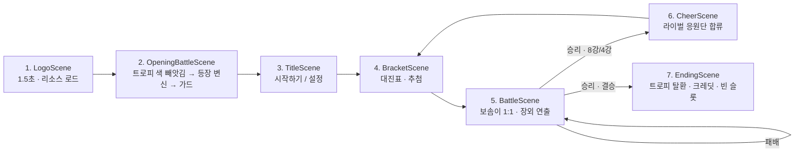

# 씬 구조와 씬플로우 v2 — 보솜이 1인 트로피 쟁탈전

> 보솜보솜 시연용 2D 실시간 배틀 웹게임 · 기준 해상도 1280×720 · Phaser 3
> 개정 2026-11-27 (v2.1: 대전 순서 확정, 결승 GenJ 노이즈 2페이즈) · 이전 태그매치 버전: `docs/archive/scene-flow_v1_tagmatch.md`
> 표기: **[확정]** CLAUDE.md 확정 · **[가정]** 바뀔 수 있으며 데이터로 조정 · **[추천]** 이 문서의 추천안(대안은 8절)

## 0. v1 → v2 변경 요약

| 항목 | v1 (태그매치) | v2 (보솜이 1인) |
|---|---|---|
| 조작 캐릭터 | 만보 ↔ 솜 태그 교체 | **보솜이 1인** |
| 목표 | 토너먼트 우승, 동료 영입 | **빼앗긴 챔피언 트로피 탈환** |
| 핵심 조작 | 태그 + 합동기 | **가드(가시 반격) + 흉내** |
| 오프닝 | 만보 위기 → 솜 난입 → 태그 튜토리얼 | 트로피 색 빼앗김 → 보솜이 등장 변신 → 가드 튜토리얼 |
| 대전 상대 | 대진 추첨 | **8강 빌드됐조 → 4강 나가자싸우자이기자 → 결승 GenJ** (예상 순위 3→2→1위) |
| 결승 연출 | 일반 경기 | **GenJ가 가려진 적의 노이즈에 씌는 2페이즈** |
| 승리 후 장면 | RecruitScene (파티 영입) | **CheerScene** (라이벌이 응원단 합류) |
| 엔딩 | 파티 전원 챔피언 | 트로피 색 복구 + 응원단 + "다음 동료는?" |

## 1. 한눈에 보기



**이야기 한 줄**: 시상대의 챔피언 트로피가 정체불명의 "가려진 적"에게 색을 빼앗긴다. 보송한 보솜이가 가시로 변신해 토너먼트에 나가 빌드됐조와 나가자싸우자이기자를 응원단으로 만들고, 결승에서 노이즈에 씌어 버린 최강 GenJ를 장외로 날려 노이즈를 걷어 내고 트로피의 색을 되찾는다.

## 2. 씬 사이에 전달되는 데이터

진행 상태는 `src/state/gameState.js`의 게임 상태 객체 하나에서만 관리합니다.

```js
{
  matchIndex: 0,              // 0=8강, 1=4강, 2=결승
  cheerers: [],               // 응원단에 합류한 라이벌 캐릭터 id (CheerScene에서 추가) [가정]
  drawDone: false,            // 대진 추첨 연출을 봤는지
  retryCount: 0,              // 현재 경기 재도전 횟수
  settings: { volume: 0.7 }   // 사운드 크기 0~1, localStorage에 저장
}
```

- v1의 `party`, `recruits`는 삭제합니다. 플레이어 캐릭터는 항상 `bosomi`입니다.
- 흉내 스킬(직전에 맞은 상대 스킬)은 **경기마다 비우는 전투 내부 상태**이며 gameState에 두지 않습니다. [추천]

| 보내는 씬 → 받는 씬 | 넘기는 값 | 게임 상태 변경 |
|---|---|---|
| Logo → Opening | 없음 | `reset()` |
| Opening → Title | 없음 | 없음 |
| Title → Bracket | 없음 | `matchIndex = 0` |
| Bracket → Battle | `{ matchIndex, opponentTeamId }` | `drawDone = true` |
| Battle → Battle (패배) | 같은 값 | `retryCount += 1` |
| Battle → Cheer (승리) | `{ matchIndex, opponentTeamId }` | `retryCount = 0` |
| Cheer → Bracket | 없음 | `cheerers`에 추가, `matchIndex += 1` |
| Battle → Ending (결승 승리) | 없음 | 없음 |

- 결승 여부는 `matchIndex === bracket.matches.length - 1`로 판단합니다.

## 3. 씬별 상세

### 3-1. LogoScene — 1.5초 (v1과 같음)
- 검은 배경에 "보솜보솜" 로고 페이드인·아웃, 데이터·이미지·사운드 선로드.
- 클릭 또는 아무 키 → 바로 다음 씬. 이 첫 클릭으로 사운드 재생 허용. [확정]
- 로드 완료 후 → OpeningBattleScene. 개별 파일 실패는 경고만 남기고 도형으로 대체.

### 3-2. OpeningBattleScene — 목표 25초 (상한 30초)
솜님 초안의 **등장 변신**과 가려진 적의 **색 빼앗기**를 그대로 오프닝으로 씁니다.

| 시간 | 장면 | 사용 에셋 |
|---|---|---|
| 0~3초 | 무대 가운데 시상대, 반짝이는 챔피언 트로피. 가려진 적이 나타나 트로피를 할퀴자 트로피가 **회색 노이즈**로 물듦 | `rival_masked_phase1` |
| 3~6초 | 하늘에서 **보송한 보솜이**가 착지. 가려진 적이 할퀴자 보솜이 털도 회색으로 번짐 | transform 01 |
| 6~8초 | 둘의 눈이 마주침 → 보솜이 머리 위 **"!"** → 털이 터지며 **가시로 변신**, 색이 돌아옴 | face_surprised → transform 01~04 |
| 8~16초 | 가려진 적의 공격 예고(빨간 번쩍임) → **가드 키 아이콘만 크게 깜빡임**(설명 문장 없음) → 가드 성공 시 "따끔!" 하고 적이 튕겨 나감 | guard 01~03 |
| 16~22초 | 공격 키 아이콘 깜빡임 → 보솜이가 몇 대 때림 | attack 01~04 |
| 22~25초 | 가려진 적이 노이즈로 흩어져 사라지고, 트로피는 회색으로 남음. 노이즈 조각 하나가 대진표 쪽으로 날아감(결승 복선) → 암전 | `texts.json` |

- **다음 씬 조건**: 암전 종료 → TitleScene
- **안전 장치**: 보솜이 체력은 1 아래로 내려가지 않습니다. 가드 안내 후 3초 동안 입력이 없으면 자동 가드. 이 씬에는 실패가 없습니다.
- 오프닝은 가려진 적을 **쓰러뜨리지 않습니다**. 장외 연출은 8강에서 처음 보여 줍니다. [추천]

### 3-3. TitleScene — 5초
- 게임 제목, 메뉴 `시작하기`·`설정`, 배경에 가시 보솜이와 **회색 트로피 실루엣**. 게임 종료 메뉴 없음. [확정]
- 설정은 같은 씬 위 패널(사운드 슬라이더, 닫기).
- `시작하기` → BracketScene

### 3-4. BracketScene — 첫 방문 8초, 이후 4초, 결승 직전 5초
- **화면**: 10개 팀 대진표(보솜보솜 + 라이벌 9팀). 결승 반대편에 GenJ가 올라와 있습니다.
- **첫 방문**: 상대 추첨 룰렛(약 3초). 결과는 `bracket.json`에 고정. [추천]
- **다시 방문**: 승리선이 다음 칸으로 이어지는 연출(1초). 관중석에 응원단 라이벌이 보입니다.
- **결승 직전**: GenJ 칸이 네온으로 번쩍이다가 한 번 회색 노이즈로 지직거림(2페이즈 복선, 약 1초 추가).
- **입력**: 다음 경기 칸 클릭 또는 `Enter` → BattleScene `{ matchIndex, opponentTeamId }`

### 3-5. BattleScene — 8강·4강 25초, 결승 30초
- **화면**
  - 위: 보솜이 체력바(표정 아이콘) / 라이벌 체력바(팀명, 얼굴)
  - 아래: 기술 아이콘 3칸 — `J` 공격, `K` 가시 구르기(쿨타임), `L` 흉내(흉내 낼 스킬이 없으면 회색)
  - 가운데: 양 끝이 열린 무대, 뒤 관중석에 응원단 라이벌
- **핵심 루프** [가정]
  1. 라이벌이 대표 스킬을 예고 후 사용
  2. 보솜이가 `Space` 가드 → 가시 상태. 닿은 상대는 "따끔!"과 함께 튕김(가시 반격), 라이벌별 **가드 반응 연출**이 나옴
  3. 맞거나 가드한 스킬이 `L` 흉내 칸에 **솜 버전**으로 저장됨 → 쓰면 상대 머리 위에 "?"
- **승리**: 상대 체력 0 → 히트 스톱 → 장외로 날아가 별이 됨 → 2초 뒤 종료
  - 8강·4강 → CheerScene / 결승 → EndingScene
- **결승(GenJ)**: 네온 조명·비 내리는 경기장. GenJ 체력 50%에서 히트 스톱 → 화면 글리치 → GenJ가 회색 노이즈에 씌어 **2페이즈**(빨라지고, 빌드됐조·나가자싸우자이기자의 스킬도 회색으로 섞어 씀 → 흉내로 되받아칠 기회 증가). 장외로 날리면 노이즈가 벗겨지고 GenJ가 원래 색으로 돌아옴. 2페이즈는 새 그림 없이 틴트·글리치 효과로 표현합니다.
- **패배**: "다시 한 번!" 1초 → 같은 경기 즉시 재시작(대진표 생략)
- **규칙 위치**: 피해, 쿨타임, 가드 판정, 흉내 저장, 승패는 `src/battle/`의 순수 함수.

### 3-6. CheerScene — 목표 4초 (v1 RecruitScene 대체)
- **화면**: 장외로 날아갔던 라이벌이 다시 걸어 들어옴 → 말풍선 "응원할게!"(라이벌별 문구, `texts.json`) → 관중석 응원단 슬롯으로 점프
- **입력**: 클릭 또는 `Enter`로 건너뜀. 입력이 없어도 자동 진행.
- **다음 씬**: BracketScene(`matchIndex + 1`). 결승 후에는 거치지 않습니다.
- v1의 "동료가 되고 싶어 한다!" 감성은 남기되, 전투에 참여하지 않으므로 개발량이 작습니다.

### 3-7. EndingScene — 목표 18초
| 단계 | 시간 | 화면 |
|---|---|---|
| ① 트로피 탈환 | 5초 | 회색 트로피에 색이 퍼지며 반짝임 → 보솜이가 트로피를 들고 victory 모션, 응원단 라이벌들이 뛰어들고 꽃가루 |
| ② 개발 로그 크레딧 | 9초 | "기획부터 구현까지 4일" → Day 1~4 한 줄씩 (`texts.json`) |
| ③ 마지막 화면 | 4초 + 유지 | "챔피언 보솜보솜의 다음 동료는?" + 빛나는 빈 슬롯 1칸 |

- ①②는 클릭으로 넘김. ③은 멈춘 채 유지(발표 멘트로 연결). `R`로만 처음으로.

## 4. 소요 시간 확인

| 순서 | 씬 | 목표 시간 | 누적 |
|---|---|---|---|
| 1 | LogoScene | 1.5초 | 0:01.5 |
| 2 | OpeningBattleScene | 25초 | 0:26.5 |
| 3 | TitleScene | 5초 | 0:31.5 |
| 4 | BracketScene (추첨) | 8초 | 0:39.5 |
| 5 | BattleScene 8강 | 25초 | 1:04.5 |
| 6 | CheerScene | 4초 | 1:08.5 |
| 7 | BracketScene | 4초 | 1:12.5 |
| 8 | BattleScene 4강 | 25초 | 1:37.5 |
| 9 | CheerScene | 4초 | 1:41.5 |
| 10 | BracketScene (결승 복선) | 5초 | 1:46.5 |
| 11 | BattleScene 결승 | 30초 | 2:16.5 |
| 12 | EndingScene (③ 도달까지) | 18초 | **2:34.5** |

- 합계 약 **2분 35초**, 여유 25초로 재도전 1회를 감당합니다. (아직 실측하지 않음)

## 5. 조작 키 [가정]

| 동작 | 키 | 보솜이 모션 |
|---|---|---|
| 이동 | `←→` 또는 `A D` | idle_spike |
| 점프 | `↑` 또는 `W` | victory 01 (AIR) 재사용 |
| 기본 공격 | `J` | attack 01~04 |
| 가시 구르기 | `K` | heavy 01~06 (몸을 말아 돌진 후 가시 폭발) |
| 흉내 | `L` | 저장된 상대 스킬의 솜 버전 |
| 가드 (가시 반격) | `Space` 누르고 있기 | guard 01~03 |

숫자 키는 시연용 단축키 전용입니다.

## 6. 시연용 단축키

| 키 | 동작 | 이동 후 상태 |
|---|---|---|
| `R` | 처음부터 다시 | 상태 초기화 → LogoScene |
| `1` | 8강으로 | 응원단 0명 |
| `2` | 4강으로 | 응원단 1명(8강 상대) |
| `3` | 결승으로 | 응원단 2명 |
| `0` | 엔딩으로 | 응원단 2명 |

- 처리 위치는 `src/main.js`의 `bindDemoHotkeys(game)` 한 곳. 로드 완료 전에는 무시합니다.
- 숫자 키는 대진표를 건너뛰고(`drawDone = true`) 응원단은 `bracket.json` 순서로 자동으로 채웁니다.

## 7. 데이터와 에셋

| 파일 | 내용 |
|---|---|
| `data/characters.json` | `bosomi`, 라이벌 9명, `rival_masked_phase1/2` |
| `data/teams.json` | 보솜보솜 + 라이벌 9팀 (팀명, 역할, 색, 대표 캐릭터) |
| `data/skills.json` | 보솜이 기술 4종 + 라이벌 대표 스킬(유형, 수치, 가드 반응 id) |
| `data/bracket.json` | 10팀 배치, 경기 순서, 고정 추첨 결과, 결승 "???" 칸 |
| `data/texts.json` | 오프닝 대사, 응원 문구, 엔딩 크레딧 |

- **라이벌 이미지**: `assets/characters/rival_*.png` 11장 준비 완료(512×512 투명). 팀 매칭은 추정 → `assets/drafts/2026-11-24_som/README.md`
- **보솜이 이미지**: 모션 시트가 설명용(체커가 찍힌 RGB)이라 그대로 못 씁니다. 투명 프레임 PNG를 솜님께 받기 전까지는 시트에서 잘라 체커를 지운 임시본 또는 도형으로 대체합니다.
- 이미지가 없으면 도형으로 대체하는 규칙(v1 6절)은 그대로 유지합니다.

**[확정] 대전 순서**: 8강 `빌드됐조`(3위, 느린 낙하기 → 가드 연습) → 4강 `나가자싸우자이기자`(2위, 음파 넉백 → 장외 위기감) → 결승 `GenJ`(1위, 네온 + 노이즈 2페이즈). 캐릭터 특징은 `docs/rival-characters.md`.

**전투 이펙트**: pixelfx(MIT)에서 30종을 스프라이트 시트로 뽑아 `assets/fx/`에 두었습니다(Phaser atlas JSON 포함). 용도별 목록은 `assets/fx/README.md`.

## 8. 결정이 필요한 항목 — 각 3안 (★ = 현재 문서에 반영한 추천안)

| # | 항목 | A | B | C |
|---|---|---|---|---|
| 1 | 가려진 적의 역할 (결승 GenJ 확정 후) | ★ 결승 GenJ가 50%에서 노이즈에 씌는 2페이즈. 새 그림 불필요, 임팩트 큼 | 오프닝 전용. 결승 승리로 트로피 색 복구 | 결승 승리 후 시상식 난입 보스전(+30초 위험) |
| 2 | 승리 후 장면 | ★ 응원단 합류(연출만, 4초). 개발량 최소, "동료" 메시지 유지 | v1처럼 영입 후 어시스트 공격. 재미↑, 개발량↑ | 씬 삭제. 시간 절약, 영입 메시지 약화 |
| 4 | 가드 키 | ★ `Space` 누르고 있기 | `S`/`↓` 누르고 있기(방향키와 한 손) | 별도 키 없이 공격 직전 `J` 타이밍 패리 |

## 9. 솜님 확인 필요
- 라이벌 시안 ↔ 팀 매칭(쇼케이스 작품과 대조해 거의 확실. 회색 2종 = 가려진 적은 확인 필요)
- 스킬 초안 원문의 잘린 줄(가드 반응 6팀, 잭팟 역할)
- 보솜이 모션 프레임을 투명 PNG로 개별 내보내기 가능 여부
- 응원 문구 9개, Day 1~4 개발 로그 문구
